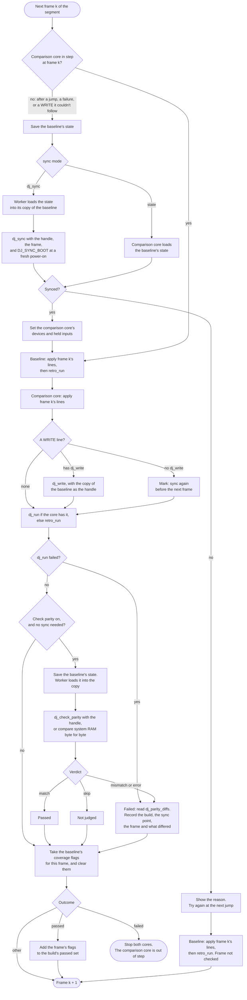
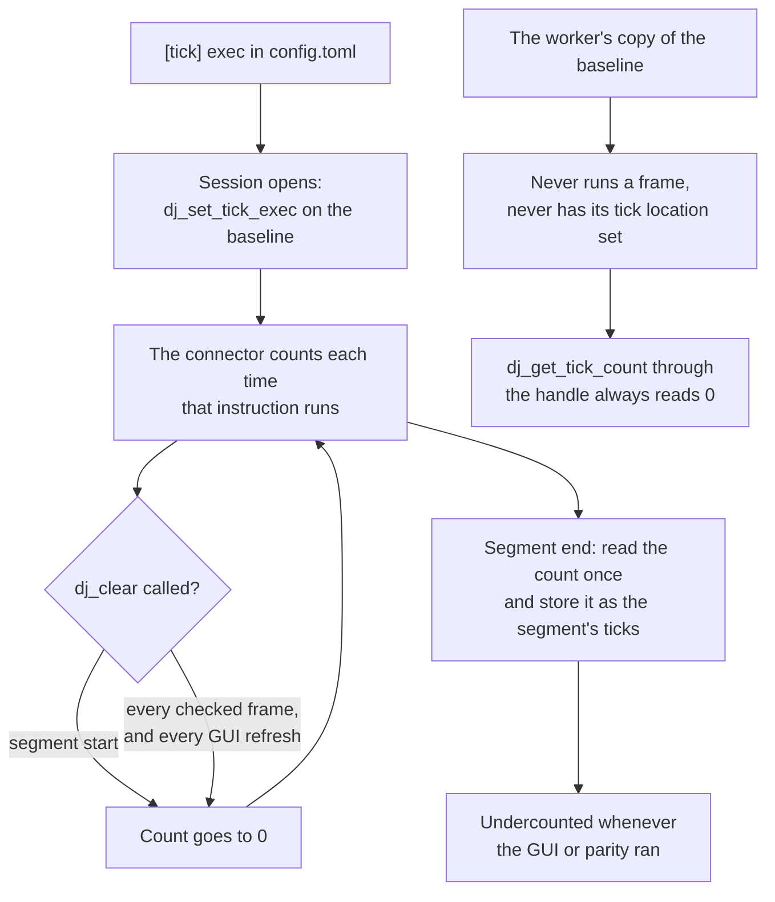
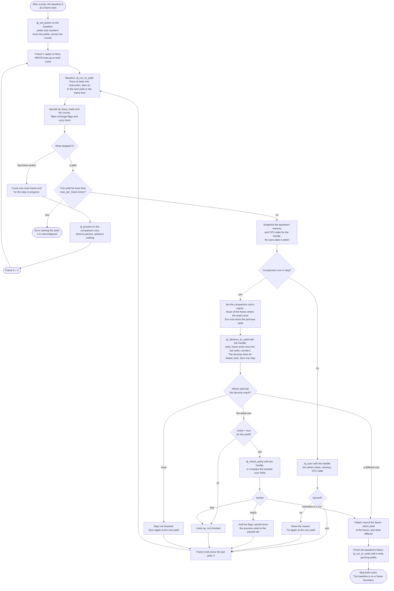
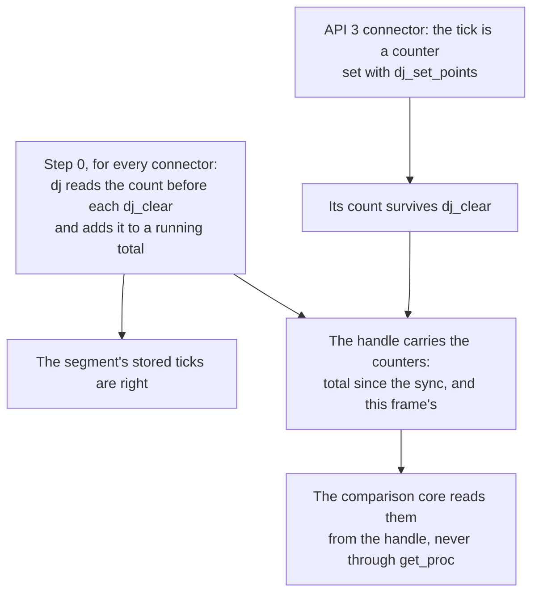
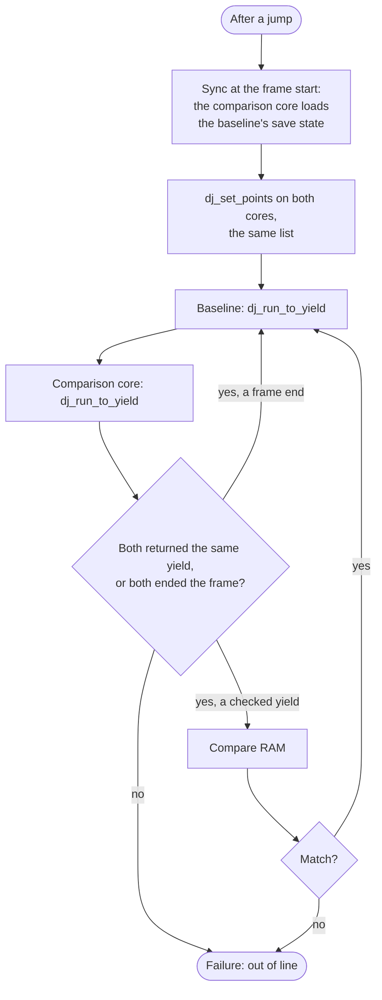
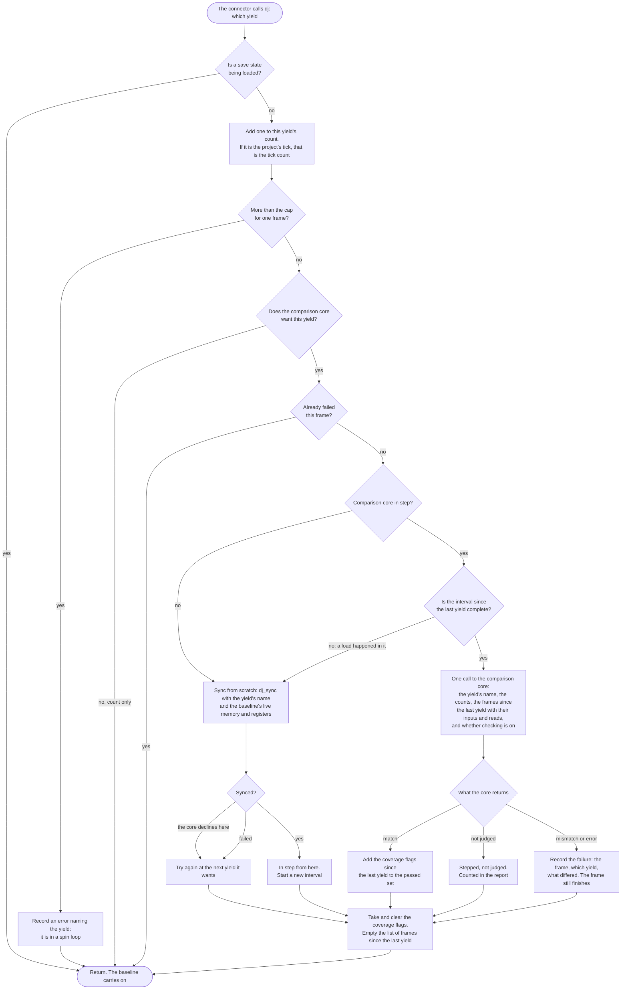
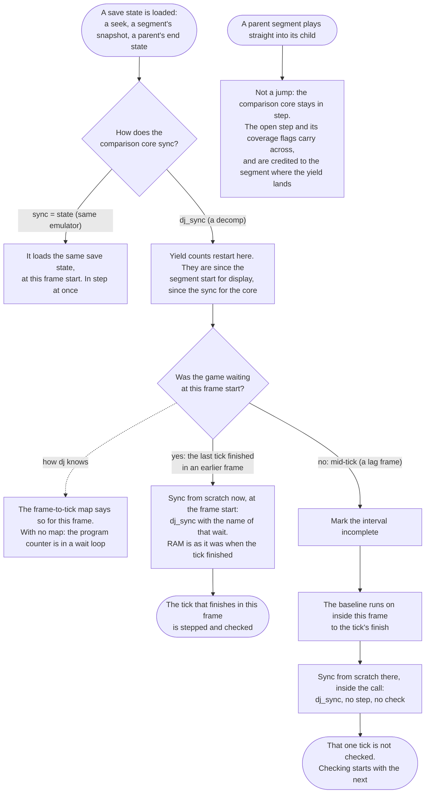
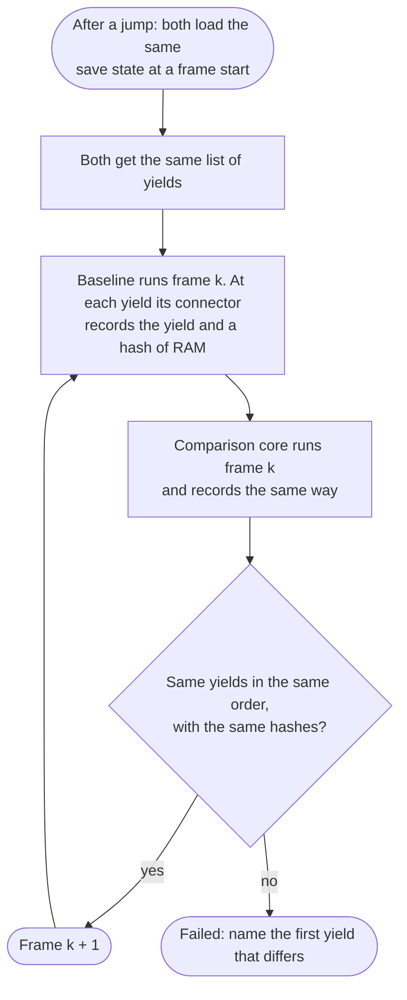

# Flow: sync, ticks and parity, now and as proposed

Written 2026-11-11 by the meta-analysis thread, to go with
[CHECKPOINT_PARITY_PLAN.md](CHECKPOINT_PARITY_PLAN.md).

- **"Now"** is what the code does today (`player/src/parity.rs`, `player/src/compare.rs`,
  `player/src/player.rs`, `gui/src/main.rs`).
- **"Abandoned"** is the first design for checking inside a frame, where the baseline
  stops at a yield and returns to dj (`dj_run_to_yield`). It was marked abandoned on
  2026-11-11 and is kept for the record only.
- **"Current proposal"**, at the end of this file, is the design that replaced it: the
  connector calls dj at each yield and the baseline never returns mid-frame. Nothing in it
  is built.

## Now: one check per frame

The comparison core runs in a worker process. The handle it gets points to a copy of the
baseline that has only had the baseline's save state loaded into it.



### Ticks, now



## Abandoned: stop-and-return checks at yields (was "Proposed")

> **Abandoned on 2026-11-11.** Do not build from this section. It covers everything from
> here down to "Sub-frame input, after the release". The design that replaced it is under
> "Current proposal: a blocking call at each yield" at the end of this file, and the
> reasons are in the plan's section "Experiments and where the design stands".
>
> What was dropped: `dj_run_to_yield` and the baseline returning to dj mid-frame, the
> `check` key per yield, and the rule that picks one frame's inputs for a step.

A yield is a place in the original's code where one step of its logic is done and it
starts to wait. The baseline stops there, mid-frame, and the comparison core runs one step
to catch up. A frame can hold no yield (a lag frame), one, or several.



### What changes for ticks (abandoned)



### The same emulator as the comparison core (`sync = "state"`) (abandoned)



### Still open in the abandoned design

| Box | What's open |
| --- | --- |
| "dj_run_to_yield … to the next yield" | How a yield in a spin loop avoids firing every iteration. The plan's thread wants a yield to be entry into a range of code; this thread found that fires on every interrupt during the wait, and suggests one-instruction yields with a list of locations |
| "Both returned the same yield, or both ended the frame?" | The plan's thread wants only the sequence of yields to match, so emulators with different timing can be compared. That leaves the comparison core's inputs undefined |
| "Set the comparison core's inputs" | A step that reads the controller in two frames gets the first frame's inputs. On Mesen, a read in the last part of scanline 240 sees the previous frame's |
| "The decomp does its vblank work" | In a lag step the handle can't say where in the step's logic the extra frame ends fell |
| Everything in "Proposed" | Not built or run. The plan's latest review asks for the Thwaite probe and a Mesen spike first |

## Sub-frame input, after the release

Not part of any flow in this file: inputs stay keyed by frame. Later, a segment line such as
`812.2 P1 JOYPAD A 1` (segment format 2) would change an input from the game's third
controller read in frame 812. The controller read count that the connector reports is what that
index would use.

## Current proposal: a blocking call at each yield

Added 2026-11-11 21:23 EST by the meta-analysis thread. It follows "Where the design
stands" in the plan's section "Experiments and where the design stands (2026-11-11 21:18
EST)". Nothing here is built, and Andrew has not signed off on every point.

A yield is a named place in the original's code. When the baseline runs it, the
connector calls a function dj gave it and waits for that function to return. The baseline
stays inside `retro_run` the whole time. `[tick]` is one of these yields: the one the
project reports as its tick.

### One frame

```mermaid
flowchart TD
    setup(["Session opens, or the comparison core loads"]) --> give["dj gives the baseline's connector<br/>the list of yields and one function to call"]
    give --> wants["The comparison core says which<br/>yields it wants to be called at"]
    wants --> fstart

    fstart["Frame k: apply its lines.<br/>WRITE lines go to both cores"] --> run["Baseline: retro_run, as today"]
    run --> hit{"The baseline runs<br/>a yield's instruction?"}
    hit -- "yes" --> call[["The connector calls dj and waits.<br/>See 'Inside the call'"]]
    call --> run
    hit -- "no, the frame ended" --> fend["retro_run returns"]

    fend --> note["dj adds frame k to the list of frames<br/>since the last yield: its number,<br/>its full input state, its controller reads"]
    note --> fcheck["dj_check_parity at the frame end,<br/>if checking is on"]
    fcheck --> fverdict{"Verdict"}
    fverdict -- "not judged" --> pic
    fverdict -- "match" --> pic["Show the comparison core's picture"]
    fverdict -- "mismatch or error" --> fail(["Failed: record the frame and what differed.<br/>Stop both cores at this frame boundary"])
    pic --> pending{"A failure was recorded<br/>inside a call this frame?"}
    pending -- "yes" --> fail
    pending -- "no" --> next(["Frame k + 1"])
    next --> fstart
```

### Inside the call

The baseline is stopped mid-frame for as long as this takes. dj may read its memory and
registers. dj must not run it, save it, load it or reset it.



### After a load or a jump

Updated 2026-11-11 22:26 EST to match the plan's section "Frames and ticks: roles, the
map, seeking, and tick start and end". The earlier chart said the first step after any
load is never checked; that holds only when the save state was taken mid-tick.

A save state is only ever taken or loaded at a frame start.



The "yes" branch relies on two things that are true for Thwaite on Mesen and not
everywhere:

- **Nothing changes RAM between the tick's finish and the frame start.** Mesen starts a
  frame at scanline 240 and the NMI comes at 241. An emulator that ends frames after the
  vblank interrupt has already run the handler, and the decomp must be told.
- **One thread.** On the N64, other threads run between the main thread's wait and the
  frame boundary.

### The same emulator as the comparison core

Two emulators can't each wait inside the other's call, so neither is called to step here.



### Still open

| Box | What's open |
| --- | --- |
| "The baseline runs a yield's instruction" | Where a yield goes in a spin loop. It has to be an instruction that runs once per wait. In Thwaite's boot, a loop at `$C430` ran `cmp nmis` 2,693 times in one frame |
| "The connector calls dj and waits" | On the N64 the game runs on a coroutine; whether its stack is big enough for the call is unchecked. A yield there must also say which thread hit it |
| "One call to the comparison core" | The name of the call, and whether it is connector API 3. API 2 connectors still need their tick functions |
| "match" | For a decomp, which bytes to ignore. The RAM-only sync run in the plan found 3 stack bytes below the stack pointer that differ without mattering |
| "its controller reads" | Only the Mesen connector is close to counting these |
| "Is a save state being loaded?" | Needed because a load on Mupen64Plus ran 1,951 distinct instructions inside `retro_unserialize` |
| Everything in this section | Not built. The plan's next step is a spike in the Mesen connector with one yield at Thwaite's game wait |
