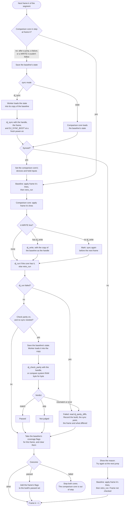
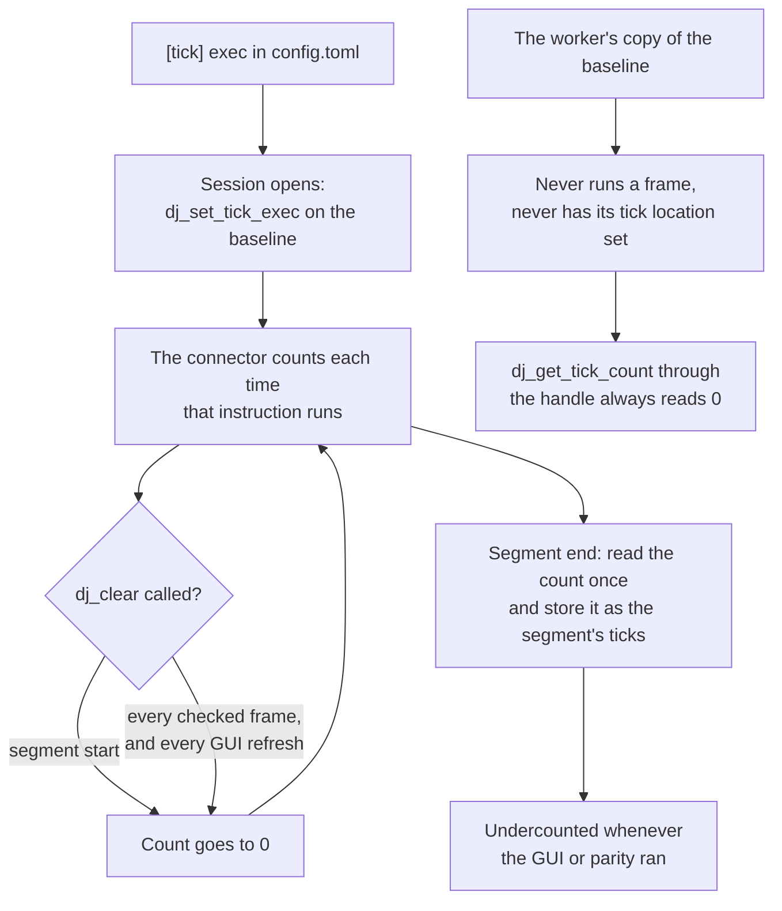
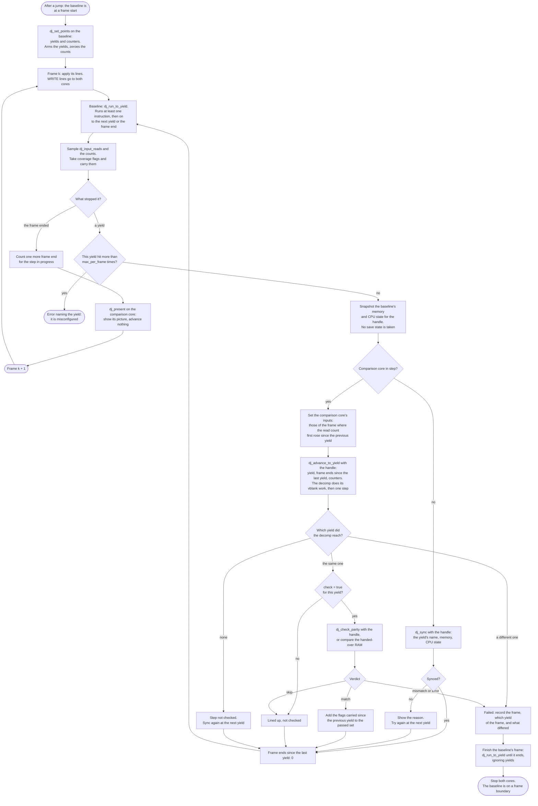
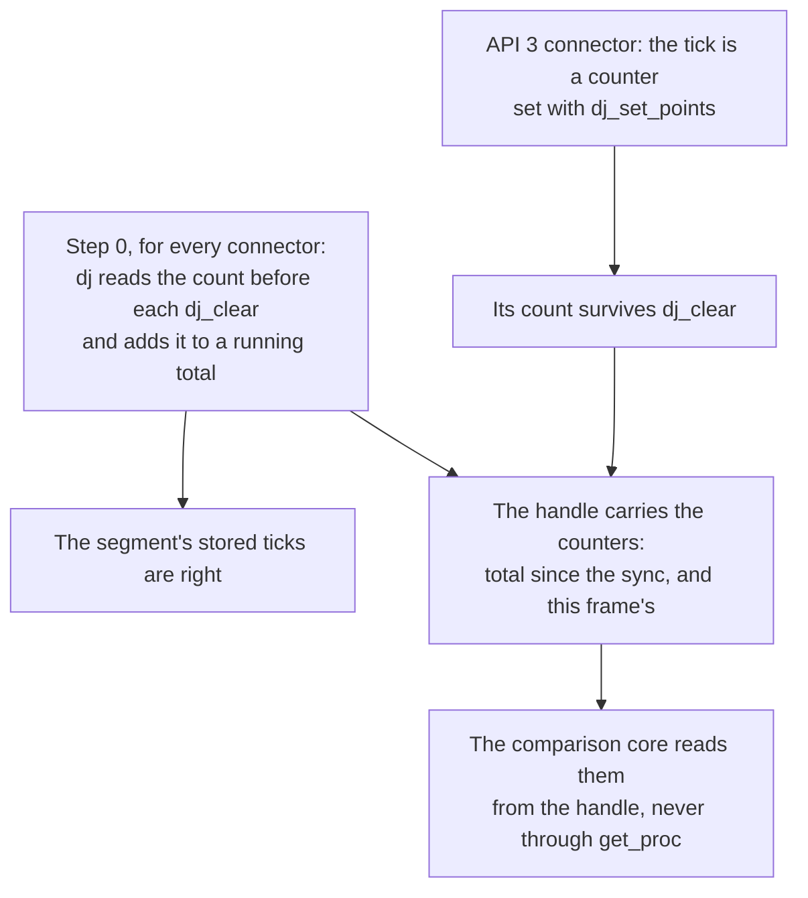
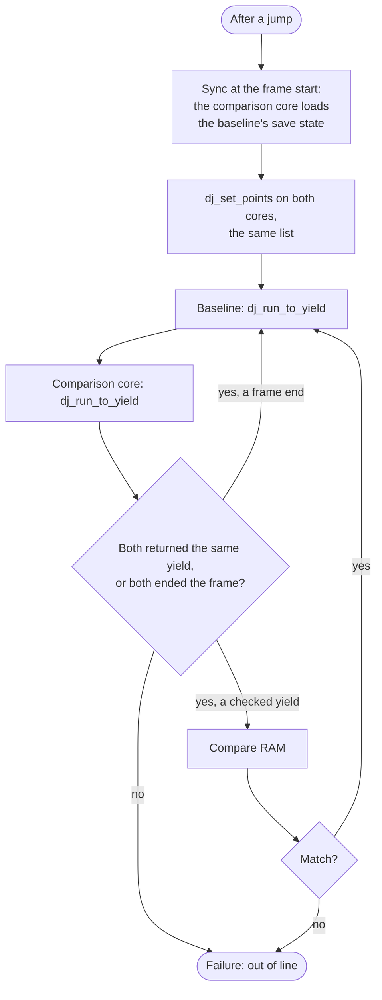
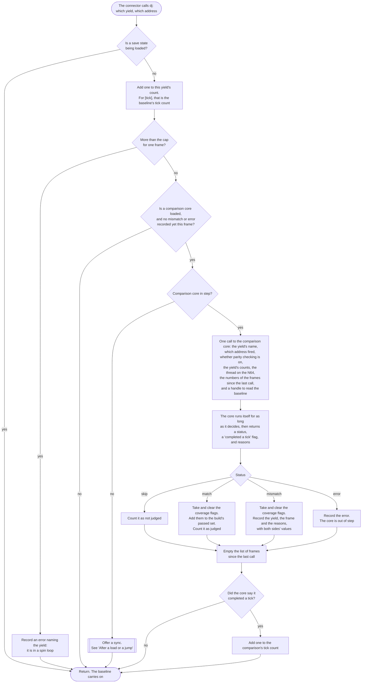
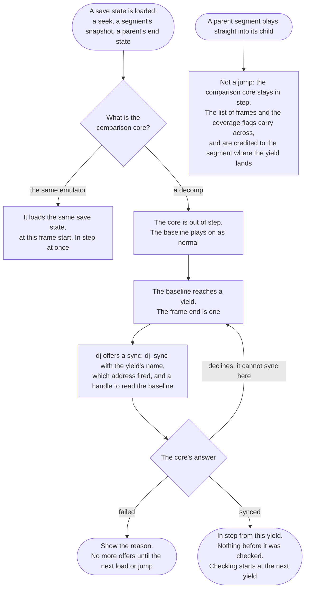
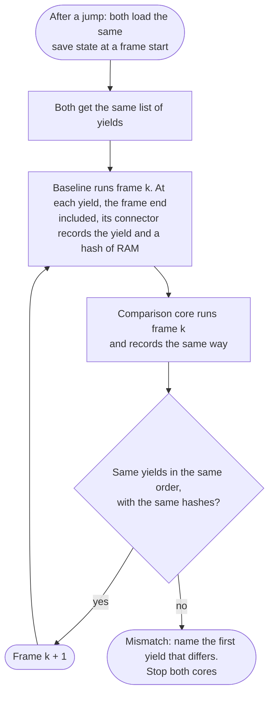

> **Archived. Agents: do not read this file unless the developer tells you to.** It is an earlier revision or a long design discussion, kept for the record, and it contradicts the current design in places. The current design is [PLAN.md](../PLAN.md), with charts in [FLOW.md](../FLOW.md).

# Flow: sync, ticks and parity, now and as proposed

Written 2026-11-11 by the meta-analysis thread, to go with
[CHECKPOINT_PARITY_PLAN.md](CHECKPOINT_PARITY_PLAN.md).

- **"Now"** is what the code does today (`player/src/parity.rs`, `player/src/compare.rs`,
  `player/src/player.rs`, `gui/src/main.rs`).
- **"Abandoned"** is the first design for checking inside a frame, where the baseline
  stops at a yield and returns to dj (`dj_run_to_yield`). It was marked abandoned on
  2026-11-11 and is kept for the record only.
- **"Current proposal"**, at the end of this file, is the design that replaced it: the
  connector calls dj at each yield and the baseline never returns mid-frame. Nothing in it
  is built.

## Now: one check per frame

The comparison core runs in a worker process. The handle it gets points to a copy of the
baseline that has only had the baseline's save state loaded into it.



### Ticks, now



## Abandoned: stop-and-return checks at yields (was "Proposed")

> **Abandoned on 2026-11-11.** Do not build from this section. It covers everything from
> here down to "Sub-frame input, after the release". The design that replaced it is under
> "Current proposal: a blocking call at each yield" at the end of this file, and the
> reasons are in the plan's section "Experiments and where the design stands".
>
> What was dropped: `dj_run_to_yield` and the baseline returning to dj mid-frame, the
> `check` key per yield, and the rule that picks one frame's inputs for a step.

A yield is a place in the original's code where one step of its logic is done and it
starts to wait. The baseline stops there, mid-frame, and the comparison core runs one step
to catch up. A frame can hold no yield (a lag frame), one, or several.



### What changes for ticks (abandoned)



### The same emulator as the comparison core (`sync = "state"`) (abandoned)



### Still open in the abandoned design

| Box | What's open |
| --- | --- |
| "dj_run_to_yield … to the next yield" | How a yield in a spin loop avoids firing every iteration. The plan's thread wants a yield to be entry into a range of code; this thread found that fires on every interrupt during the wait, and suggests one-instruction yields with a list of locations |
| "Both returned the same yield, or both ended the frame?" | The plan's thread wants only the sequence of yields to match, so emulators with different timing can be compared. That leaves the comparison core's inputs undefined |
| "Set the comparison core's inputs" | A step that reads the controller in two frames gets the first frame's inputs. On Mesen, a read in the last part of scanline 240 sees the previous frame's |
| "The decomp does its vblank work" | In a lag step the handle can't say where in the step's logic the extra frame ends fell |
| Everything in "Proposed" | Not built or run. The plan's latest review asks for the Thwaite probe and a Mesen spike first |

## Sub-frame input, after the release

Not part of any flow in this file: inputs stay keyed by frame. Later, a segment line such as
`812.2 P1 JOYPAD A 1` (segment format 2) would change an input from the game's third
controller read in frame 812. The controller read count that the connector reports is what that
index would use.

## Current proposal: a blocking call at each yield

Added 2026-11-11 21:23 EST by the meta-analysis thread. Last rewritten 2026-11-12 21:35 EST, when
the design was settled enough to move to its own folder. **The same charts, without the
history on this page, are in [yield-parity/FLOW.md](FLOW.md), and the
design is written out in [yield-parity/PLAN.md](PLAN.md). Build from
those.** Nothing here is built.

What changed in this last rewrite, with the plan section that decided it:

- The comparison core no longer subscribes to yields; every yield is passed to it, and
  it answers "skip" for one it disregards. Yields have no N64 guard. ("Yield config, the
  call, and patch files")
- The statuses are match, mismatch, skip and error, with a "completed a tick" flag. The
  core gives every verdict; dj compares no memory itself. (the same section, and "Final
  round")
- A mismatch or an error stops playback at the frame boundary. There is no halt setting
  and no time limit box. (the same sections)
- After a load, dj offers a sync at every yield, the frame end included, and the core
  accepts where it can. Checkpoints and the "is this a tick start?" test are gone.
  ("Final round")

### One frame

```mermaid
flowchart TD
    setup(["Session opens"]) --> arm["dj gives the baseline's connector the yields:<br/>the [tick] and [[yield]] entries.<br/>The frame end is always one"]
    arm --> fstart

    fstart["Frame k: apply its input lines to both cores.<br/>A WRITE line goes to the baseline<br/>and puts a decomp out of step"] --> run["Baseline: retro_run, as today"]
    run --> hit{"The baseline reaches<br/>a yield's address?"}
    hit -- "yes" --> call[["The connector calls dj and waits.<br/>See 'At a yield'"]]
    call --> run
    hit -- "no, the frame ended" --> fend["retro_run returns"]

    fend --> note["dj adds frame k's number to the list of frames<br/>since the last call to the comparison core"]
    note --> fcall[["The frame-end yield: the same handling<br/>as 'At a yield', with the baseline between frames"]]
    fcall --> pic["Show the comparison core's picture"]
    pic --> lost{"Was a mismatch or an error<br/>recorded at any yield this frame?"}
    lost -- "no" --> next(["Frame k + 1"])
    lost -- "yes" --> halt(["Stop both cores at this frame boundary.<br/>Show the yield and the reasons.<br/>A user or an agent may step on by hand"])
    next --> fstart
```

### At a yield

The baseline is stopped, mid-frame unless this is the frame end, for as long as this
takes. dj may read its memory and registers. dj must not run it, save it, load it or
reset it. Whatever the answer, the call returns and the frame finishes.



The core gives every verdict. dj does not compare memory itself and keeps no list of
bytes to ignore. "skip" covers a yield the core disregards, an overlay it is not built
for, and checking being off.

### After a load or a jump

A save state is only ever taken or loaded at a frame start. dj does not manage a
comparison core's memory: the core brings itself fully into step from the baseline.



A project with no `[tick]` and no `[[yield]]` has only the frame end, so its decomp
syncs at a frame boundary. That is what works today for Tetris. A decomp of a game whose
frame ends fall inside a tick (No Mercy's tag match) declines the frame end and syncs at
its tick.

### The same emulator as the comparison core

Two emulators can't each wait inside the other's call, so neither is called at a yield.
With only the frame end this is today's check: one comparison per frame.



### Still open

See "Open problems" in [yield-parity/PLAN.md](PLAN.md).
