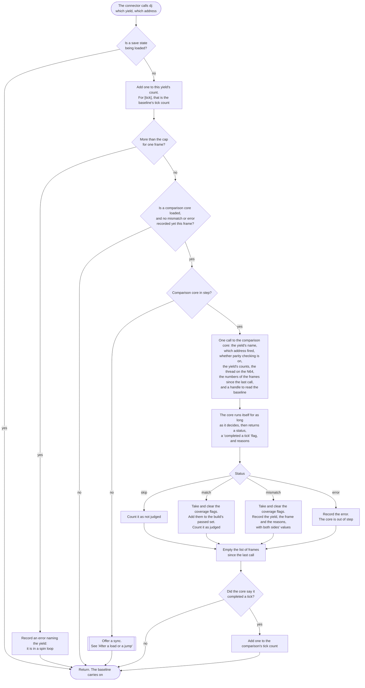
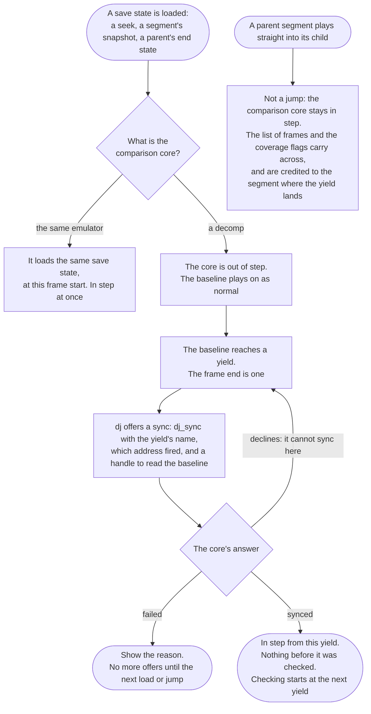
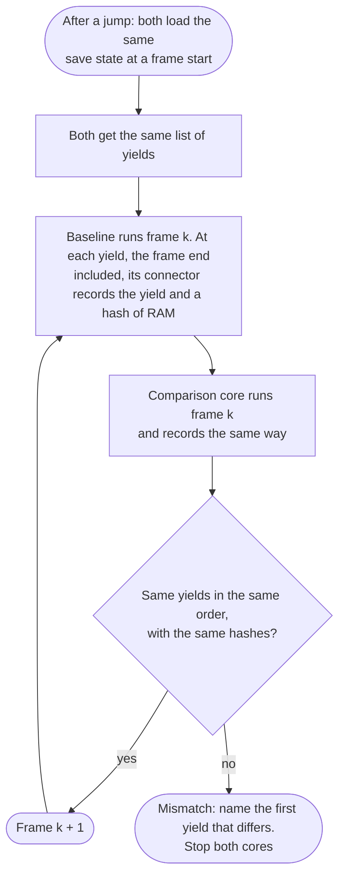

> **Archived. Agents: do not read this file unless the developer tells you to.** It is an earlier revision or a long design discussion, kept for the record, and it contradicts the current design in places. The current design is [PLAN.md](../PLAN.md), with charts in [FLOW.md](../FLOW.md).

# Flow: yields, sync and parity

Written 2026-11-12 21:35 EST by the meta-analysis thread. This is the design in
[PLAN.md](PLAN.md) as charts. Nothing here is built.

A yield is a named place where the baseline calls dj and waits. `[tick]` and each
`[[yield]]` in the project config is one; the frame end is always one. dj passes every
yield to the comparison core, which answers match, mismatch, skip or error.

How dj works today, and the designs that were dropped on the way here, are in
[../CHECKPOINT_PARITY_FLOW.md](CHECKPOINT_PARITY_FLOW.md).

## One frame

```mermaid
flowchart TD
    setup(["Session opens"]) --> arm["dj gives the baseline's connector the yields:<br/>the [tick] and [[yield]] entries.<br/>The frame end is always one"]
    arm --> fstart

    fstart["Frame k: apply its input lines to both cores.<br/>A WRITE line goes to the baseline<br/>and puts a decomp out of step"] --> run["Baseline: retro_run, as today"]
    run --> hit{"The baseline reaches<br/>a yield's address?"}
    hit -- "yes" --> call[["The connector calls dj and waits.<br/>See 'At a yield'"]]
    call --> run
    hit -- "no, the frame ended" --> fend["retro_run returns"]

    fend --> note["dj adds frame k's number to the list of frames<br/>since the last call to the comparison core"]
    note --> fcall[["The frame-end yield: the same handling<br/>as 'At a yield', with the baseline between frames"]]
    fcall --> pic["Show the comparison core's picture"]
    pic --> lost{"Was a mismatch or an error<br/>recorded at any yield this frame?"}
    lost -- "no" --> next(["Frame k + 1"])
    lost -- "yes" --> halt(["Stop both cores at this frame boundary.<br/>Show the yield and the reasons.<br/>A user or an agent may step on by hand"])
    next --> fstart
```

## At a yield

The baseline is stopped, mid-frame unless this is the frame end, for as long as this
takes. dj may read its memory and registers. dj must not run it, save it, load it or
reset it. Whatever the answer, the call returns and the frame finishes.



The core gives every verdict. dj does not compare memory itself and keeps no list of
bytes to ignore. "skip" covers a yield the core disregards, an overlay it is not built
for, and checking being off.

## After a load or a jump

A save state is only ever taken or loaded at a frame start. dj does not manage a
comparison core's memory: the core brings itself fully into step from the baseline.



A project with no `[tick]` and no `[[yield]]` has only the frame end, so its decomp
syncs at a frame boundary. That is what works today for Tetris. A decomp of a game whose
frame ends fall inside a tick (No Mercy's tag match) declines the frame end and syncs at
its tick.

## The same emulator as the comparison core

Two emulators can't each wait inside the other's call, so neither is called at a yield.
With only the frame end this is today's check: one comparison per frame.


