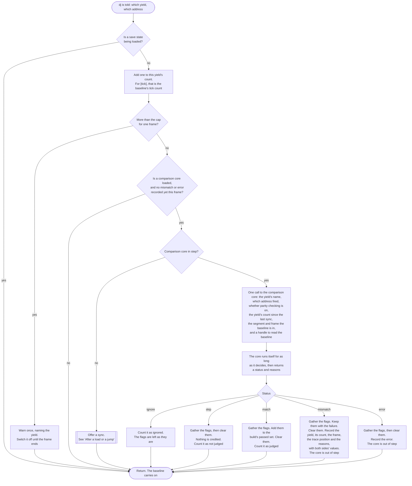
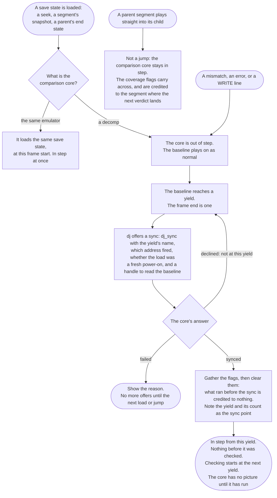
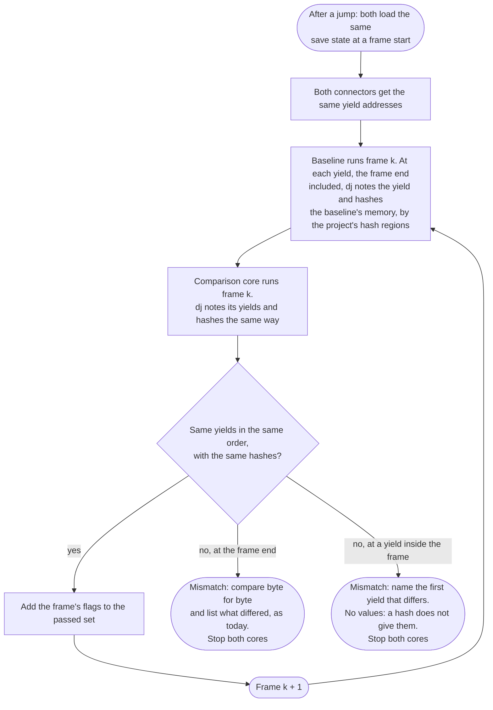

> **Archived. Agents: do not read this file unless the developer tells you to.** It is an earlier revision or a long design discussion, kept for the record, and it contradicts the current design in places. The current design is [PLAN.md](../PLAN.md), with charts in [FLOW.md](../FLOW.md).

# Flow: yields, sync and parity (revision 2)

Written 2026-11-13 16:56 EST. This is the design in [PLAN_2.md](PLAN_2.md) as charts. It
replaces [FLOW.md](FLOW.md), which is left as it was. Nothing here is built.

A yield is a named place where dj is told the baseline has arrived, and the baseline
waits. `[tick]` and each `[[yield]]` in the project config is one; the connector calls dj
there. The frame end is always one, named `frame_end`; dj raises it itself after
`retro_run` returns. dj passes every yield to the comparison core, which answers match,
mismatch, skip, ignore or error.

What differs from FLOW.md:

- The frame end is dj's own yield, not the connector's.
- "Skip" is split into "skip" and "ignore".
- A yield over the cap is switched off for the frame with a warning. It is not an error.
- dj gathers the coverage flags for the recording and the live view before it clears
  them, and clears them at a skip and at a sync.
- The call carries the current frame, not a list of frames, and no N64 thread.
- There is no "completed a tick" flag.
- A mismatch puts the comparison core out of step.
- A sync has three answers and says whether the load was a power-on.
- For two emulators, dj does the hashing.

## One frame

```mermaid
flowchart TD
    setup(["Session opens"]) --> arm["dj gives the baseline's connector the addresses<br/>of the [tick] and [[yield]] entries,<br/>and the function to call at each"]
    arm --> fstart

    fstart["Frame k: apply its input lines to both cores.<br/>A WRITE line goes to the baseline<br/>and puts a decomp out of step.<br/>Yields switched off by the cap are on again"] --> run["Baseline: retro_run, as today"]
    run --> hit{"The baseline reaches<br/>a yield's address?"}
    hit -- "yes" --> call[["The connector calls dj and waits.<br/>See 'At a yield'"]]
    call --> run
    hit -- "no, the frame ended" --> fend["retro_run returns"]

    fend --> fcall[["dj raises the frame_end yield itself:<br/>the same handling as 'At a yield',<br/>with the baseline between frames"]]
    fcall --> pic["Show the comparison core's latest picture"]
    pic --> lost{"Was a mismatch or an error<br/>recorded at any yield this frame?"}
    lost -- "no" --> next(["Frame k + 1"])
    lost -- "yes" --> halt(["Stop both cores at this frame boundary.<br/>Show the yield and the reasons.<br/>The comparison core is out of step"])
    next --> fstart
```

## At a yield

The baseline is stopped, mid-frame unless this is the frame end, for as long as this
takes. dj may read its memory and registers. dj must not run it, save it, load it or
reset it. Whatever the answer, the call returns and the frame finishes.

"Gather the flags" means: add the connector's coverage flags to the recording in
progress and to the GUI's live view. Both otherwise read them only after a frame, and
would lose what ran before a clear in the middle of one.



The core gives every verdict. dj does not compare memory itself and keeps no list of
bytes to ignore.

- **"Ignore"** is for a yield the core does not act on, such as the frame end for a core
  that judges at its tick, or `pads_read`, where it only copies the pad buffer. The code
  that ran counts towards the next verdict.
- **"Skip"** is for a stretch the core cannot vouch for: an overlay it is not built for,
  a load, or checking being off. The code that ran is credited to nothing.
- **The share judged** is match and mismatch over match, mismatch and skip.

## After a load or a jump

A save state is only ever taken or loaded at a frame start. dj does not manage a
comparison core's memory: the core brings itself fully into step from the baseline.



A project with no `[tick]` and no `[[yield]]` has only the frame end, so its decomp
syncs at a frame boundary. That is what works today for Tetris. A decomp of a game whose
frame ends fall inside a tick (No Mercy's tag match) declines the frame end and syncs at
its tick.

The frame in which a sync happens is never checked. After a mismatch the next sync
replaces the comparison core's drifted state, so drift cannot be watched as it plays on.

## The same emulator as the comparison core

Two emulators can't each wait inside the other's call, so neither is asked for a
verdict. Each connector calls dj at every yield as usual, and dj does the hashing there.
This is the one place where dj compares memory itself. With only the frame end this is
today's check: one comparison per frame.


