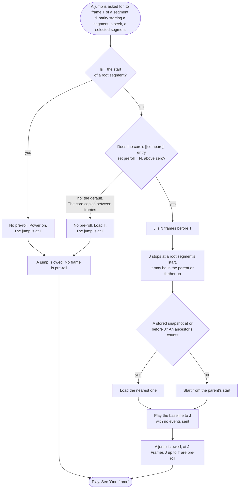
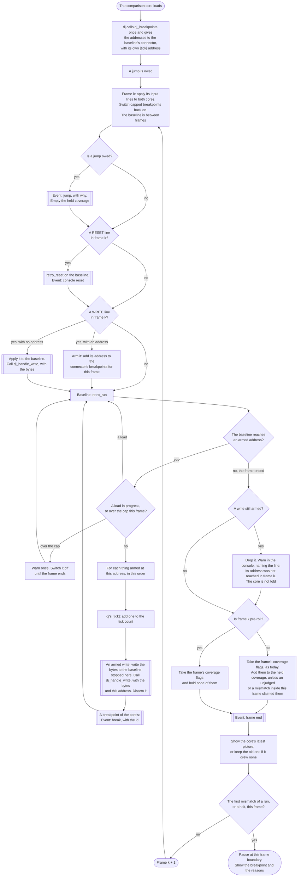
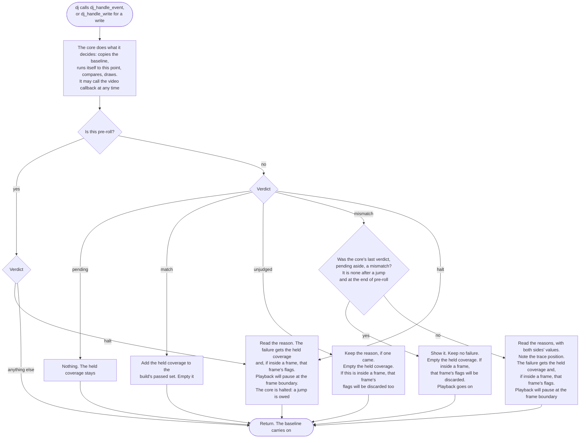
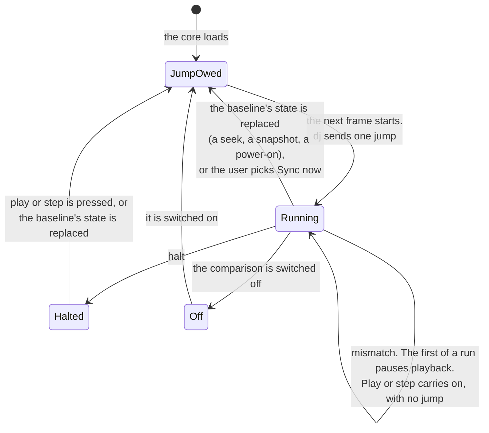
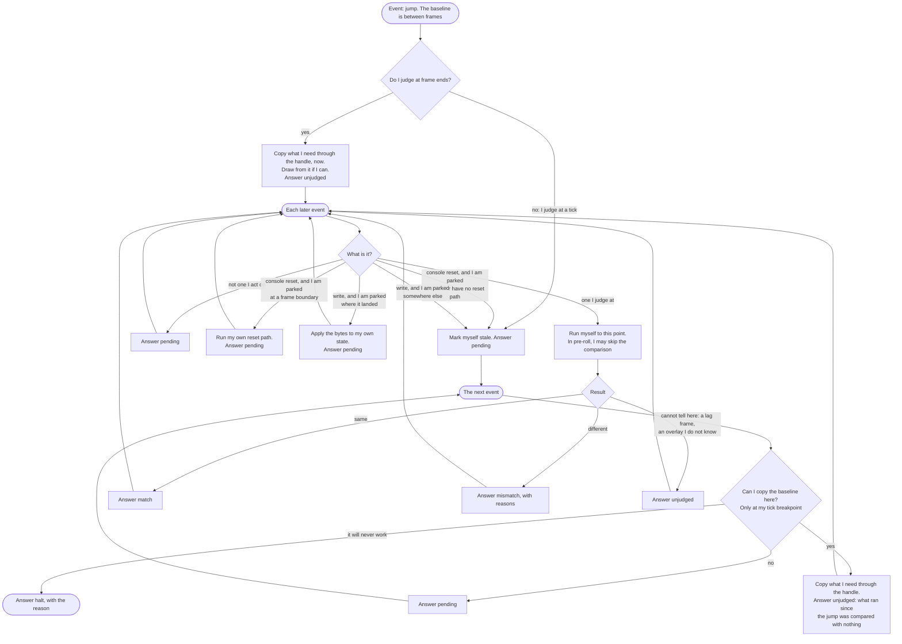

# Flow: parity by breakpoints

Written 2026-11-15 15:20 EST; rewritten 16:28 EST, revised 16:57 and 17:30 EST with
[PLAN.md](PLAN.md). This is the design in that file as charts. The same rules as tables
of cases, with worked examples, are in [STATES.md](STATES.md). Earlier charts are in
[archive/](../_archive/yield-parity/); agents should not read those unless the developer says to. Nothing
here is built.

The comparison core lists breakpoints in the original game. dj runs the baseline and
calls the core with an event at each one, and at each frame end. The core runs itself
and answers pending, match, mismatch, unjudged or halt. dj does not sync the core or
track whether it is live.

A comparison core that is the same emulator as the baseline is not in these charts. It
is checked at the frame end as it is today.

## Where the baseline starts after a jump

Only when checking parity. Playing straight on from a parent into its child is not a
jump and skips this.

The jump is sent at J whatever snapshot was loaded, so a failure re-runs the same way on
a machine with other snapshots.

"Copy again" jumps have no pre-roll: Sync now, play after a halt, and switching the
comparison on. Nothing is loaded, so there is nowhere earlier to start.

## One frame

- Every event carries the segment and frame, whether the frame is pre-roll, and a handle
  that reads the baseline's memory and registers.
- No event is sent while the core is halted, or while the comparison is switched off.
- Most addresses have only one thing armed. The order matters when a write and a
  breakpoint of the core's share one: the core sees the write before it compares.
- Each event carries a frame number: between frames, the frame about to run; inside a
  frame, the frame running; at a frame end, the frame just run.
- The first mismatch of a run, or a halt, answered between frames pauses playback there,
  before the frame runs. The chart shows the usual case, where it comes inside the frame
  or at its end.
- A core with no `dj_handle_write` is not called for a write. dj owes it a jump before
  the next frame instead, and for a write with an address treats the rest of that frame
  as unjudged.

## An event and its verdict

The call blocks for as long as the core takes.

With parity checking off, dj discards match, mismatch and unjudged; a halt still stops
playback.

A verdict given between frames (to a jump, a console reset, or a write with no address)
never touches the frame ahead, which has not run. In pre-roll a halt's failure gets only
the flags of the frame it happened in.

## What the core is sent over time

dj keeps two facts about the comparison core: whether a jump is owed, and whether it is
halted. Everything else is the core's own.

- **Several loads owe one jump.** Dragging the ruler loads many states; the core hears
  of it once, before the next frame that runs.
- **A parent segment playing into its child changes nothing.** No state was replaced. If
  the parent's last frame ended mid-tick, the core stays parked at its last breakpoint
  until the child plays, and its held coverage goes with it.
- **The jump says why:** a fresh power-on, a replaced state, or "nothing was replaced,
  copy again".

## What a core does after a jump

This is the core's own logic, not dj's. It is shown because it replaces dj's sync. The
helper header shipped with dj does it for a core that keeps the original's RAM layout.

After a mismatch the core keeps its own state, and play or step carries on with no
jump. Whether it then drifts, matches again, or copies the baseline afresh is the core's
choice. "Sync now" sends a jump and makes it copy.

The "answer unjudged" on the jump event claims nothing: it comes between frames, so the
frame that follows is still credited by its own match.

A core is parked where a write landed in two cases: it judges at frame ends and the
write had no address, or it has a breakpoint at the write's instruction address.
