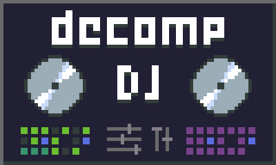

  

# decomp-dj

### Streamlined dynamic analysis and playtesting for retro game decomps

* Store and edit git-friendly, branching input replays.
* Build caches of incremental memory snapshots on developer machines to navigate to any game state in real-time.
* Avoid having to commit massive blobs of (potentially copyright-violating) reference savestates.
* Automate regression testing on decomps by running them side-by-side with the original game.
* Track and visualize coverage and decomp parity at function and block levels.
* Cache xrefs of replay frames to executed code blocks, enabling rapid tracing of unknown functions and rare branches.
* MCP-enabled, allowing agents to:
  * jump, step, and trace through metadata-rich gameplay segments
  * fuzz and test game logic
  * decomp with more accurate comments and symbol names
  * learn to play the game (or even create whole new replay segments on your behalf)
  * catch exactly when and why a decomp loses parity with the original game
  * stop asking you to pause the game in specific states

## License

decomp-dj is free software under the [GNU General Public License v3.0 or later](LICENSE.txt).
Its source, for every release, is in this repository at the release's tag.

Some parts are MIT so they can go into code under any licence: the decoder plugin header
and SDK (`decoders/`: [decoders.md](docs/decoders.md)) and the new files in the mGBA
connector. Each connector's patch takes its emulator's licence, as
its README in [connectors/](connectors/) says. Cores aren't included.