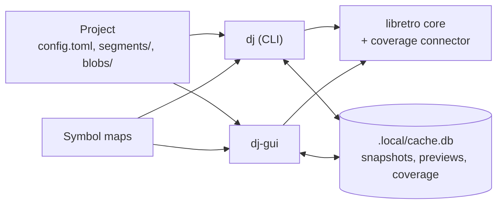

# decomp-dj

decomp-dj records plain-text input segments that drive a libretro core from power-on into
every situation a game can reach, and measures which parts of the ROM those segments run.
It is built for decompilation projects: the segments show which code is covered and where
to go next, they replay byte for byte on any machine, and later they will check a
decompiled game against the original.

A project is a tree of segments. Each segment starts where its parent ends, carries its
inputs by frame, and records state hashes that prove it still plays the same. The project
is small text files that live in version control. Everything heavy (snapshots, previews,
coverage) is rebuilt locally by playing it.



## Status

A working prototype, tested end to end on [Thwaite](examples/thwaite/), a free NES game:
12 segments replay their hashes on Linux and macOS, and cover 80.2% of its instructions
([results](.agents/RESULTS.md)). Two cores have coverage connectors: Mesen (NES) and, in a
first version, Mupen64Plus-Next (N64); coverage rolls up into functions and blocks for 6502
and MIPS code. A decompiled game built as a libretro core can play beside the original in
the GUI and be checked for parity frame by frame. Limits and plans are in the
[roadmap](.agents/ROADMAP.md).

## Quick start

```sh
cd player && cargo build --release && cd ..      # dj
cd gui && cargo build --release && cd ..         # dj-gui
connectors/mesen/build.sh                        # the NES core with coverage
(cd examples/thwaite && ./build-rom.sh)
player/target/release/dj run examples/thwaite --rom examples/thwaite/build/thwaite.nes --core build/cores/mesen_libretro.so
gui/target/release/dj-gui examples/thwaite
```

Details, and starting your own project, are in [install.md](docs/install.md).

## Docs

| Doc | What it covers |
| --- | --- |
| [concepts.md](docs/concepts.md) | Terms and colors used everywhere |
| [install.md](docs/install.md) | Building, the example, a first project |
| [config.md](docs/config.md) | `config.toml` and `.local/local.toml`, every key |
| [segments.md](docs/segments.md) | Project layout, segment files, blobs |
| [playback.md](docs/playback.md) | Playing segments, state hashes, ticks, clean and dirty |
| [editing.md](docs/editing.md) | Tree edits, the piano roll, markers, undo |
| [database.md](docs/database.md) | The local database: hydrating, snapshots, seeking |
| [coverage.md](docs/coverage.md) | Coverage, unreachable code, symbol maps, reports, the ROM map |
| [cli.md](docs/cli.md) | Every `dj` command |
| [gui.md](docs/gui.md) | A tour of `dj-gui` |
| [connectors.md](docs/connectors.md) | The coverage API, and adding a core |
| [mcp.md](docs/mcp.md) | `dj mcp`: queries, traces, sessions, drafts and search jobs for AI agents |

**Format version 1** is defined by [segments.md](docs/segments.md),
[playback.md](docs/playback.md), the tree edits in [editing.md](docs/editing.md#tree-edits)
and [config.md](docs/config.md). Items marked **(reserved)** may appear in files, but the
tools don't act on them yet.

Work in progress lives in [.agents/](.agents/): the [roadmap](.agents/ROADMAP.md), the
[local database design](.agents/CACHE_PLAN.md) and [results](.agents/RESULTS.md).

## Repository

| Path | What it is |
| --- | --- |
| [player/](player/) | `dj`, the headless player (Rust), and the `decomp_dj` library both tools use |
| [gui/](gui/) | `dj-gui`, the desktop viewer and editor (Rust, egui) |
| [connectors/](connectors/) | Per-core coverage patches: [mesen](connectors/mesen/) (NES) and [mupen64plus](connectors/mupen64plus/) (N64) |
| [examples/thwaite/](examples/thwaite/) | The end-to-end test project |
| [examples/tetris/](examples/tetris/) | A commercial game (bring your own ROM), with a C decomp built as a comparison core |
| [scripts/](scripts/) | Helpers: the MCP smoke test, and `func_toml_to_csv.py` for N64 symbol maps |
| [docs/](docs/) | User documentation |

**Housekeeping before a release:** `player/examples/` holds only scratch tools
(`ramtrace.rs`, a RAM trace of a segment chain; `n64_roundtrip.rs`, the save-state
round-trip harness for connector work, `.agents/CONNECTOR_PLAN.md`); delete the directory
once they're no longer needed.
