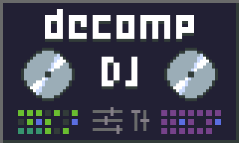

  

# decomp-dj

### Streamlined dynamic analysis and playtesting for retro game decomps and ports

* Create and edit git-friendly, branching input replays.
* Build caches of incremental memory snapshots on developer machines to navigate to any game state in real-time.
* Avoid having to commit massive blobs of (potentially copyright-violating) reference savestates.
* Automate regression testing on decomps by running them side-by-side with the original game, interactively or via the headless CLI for CI/CD.
* Track and visualize coverage and parity at function and block levels.
* Cache xrefs of replay frames to executed code blocks, enabling rapid tracing of unknown functions and rare branches.
* Connect your AI agent to the MCP, allowing it to:
  * jump, step, and trace through metadata-rich gameplay segments
  * fuzz and test game logic
  * decomp with more accurate comments and symbol names
  * learn to play the game (or even create whole new replay segments on your behalf)
  * catch exactly when and why a decomp loses parity with the original game

## What this project is for

Decompiling and/or porting a retro game is an arduous task, even with AI assistance:
* Byte-exact decomps are costly and time-consuming, but non-matching decomps can have subtle bugs that need to be tested for.
* Accurate symbol names and comments usually require interactive, dynamic analysis.
* Porting is required to avoid emulating the original syscalls on modern hardware, but introduce inaccuracies due to the sensitivity of game logic to clock speeds and vertical refresh rates on original hardware.

These issues require the developer(s) to emulate the games and play them into specific states for dynamic analysis and comparison, often leaving a messy trail of save states on their local machines. These save states are sometimes 16 MB or larger, and often contain copyrighted data, so they cannot be committed to an open-source repo for collaborators. AI agents also tend reference these files in clean-room analysis and documentation, leading to confusing mentions of files called `about_to_land_power_atk_on_abb_lvl_6_again.sav` that don't live in the repo.

`decomp-dj` solves these issues by assuming that the baseline -- a ROM and emulator pinned by hash/version -- is input-deterministic (or can reasonably be made so) and therefore all states in the game can be reached within a branching series of input sequences. These sparse, text-based input sequences can be committed to the repo, allowing any collaborators to create, modify, and view them as needed. Playing these sequences back creates a cache of efficiently paged memory snapshots on the local machine, allowing for rapid navigation between game states for dynamic analysis and tracing.

## Quick Start

TODO

## License

decomp-dj is free software under the [GNU General Public License v3.0 or later](LICENSE.txt).
Its source, for every release, is in this repository at the release's tag.

Some parts are MIT so they can go into code under any licence: the decoder plugin header
and SDK (`decoders/`: [decoders.md](docs/decoders.md)) and the new files in the mGBA
connector. Each connector's patch takes its emulator's licence, as
its README in [connectors/](connectors/) says. Cores aren't included.